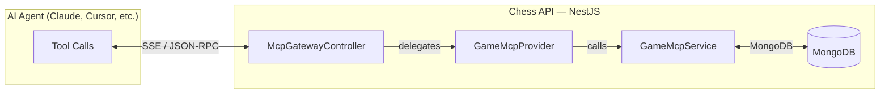
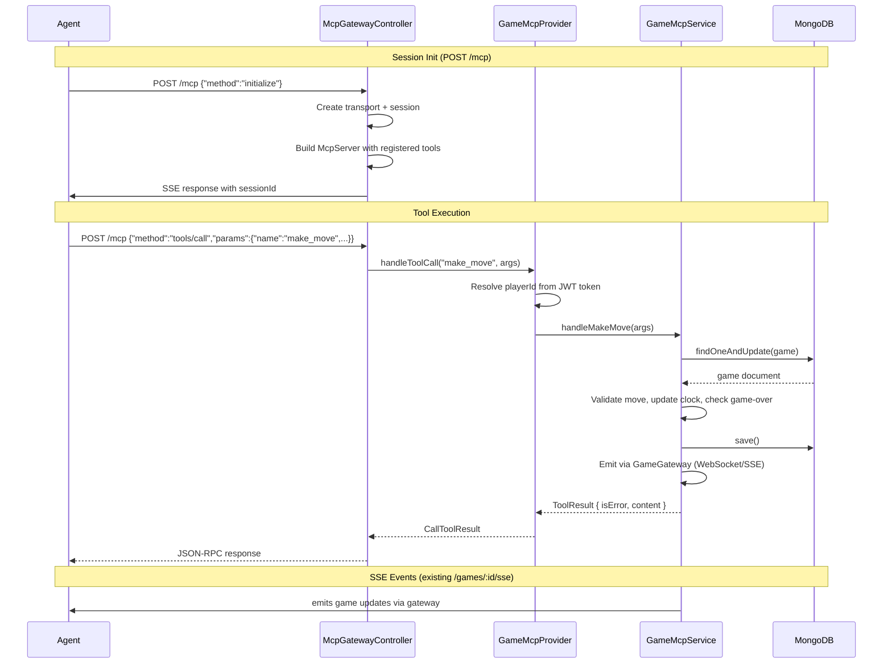

# Chess API — Model Context Protocol (MCP)

A built-in MCP server lets AI agents play chess games directly through the API. Agents can create games, make moves, view board states, and claim timeouts using standard MCP tool calls.

## Quick Start

```bash
# Get your guest token
curl -X POST http://localhost:3000/auth/guests

# Connect MCP (replace $TOKEN and $SESSION with actual values)
curl -sf -X POST http://localhost:3000/mcp \
  -H "Authorization: Bearer $TOKEN" \
  -d '{"jsonrpc":"2.0","id":1,"method":"initialize","params":{"protocolVersion":20241105}}'

# Call a tool
curl -sf -X POST http://localhost:3000/mcp \
  -H "Authorization: Bearer $TOKEN" \
  -d '{
    "jsonrpc": "2.0",
    "id": 2,
    "method": "tools/call",
    "params": {
      "name": "create_game",
      "arguments": { "playerId": "<game-id>", "duration": "5min" }
    }
  }'
```

See [scripts/test-mcp.sh](../scripts/test-mcp.sh) for a full manual test suite.

## Architecture



### Module Structure

```
src/mcp/
├── mcp.module.ts          # Dynamic module (imports GameModule, PlayerModule, JwtModule)
├── mcp.controller.ts      # HTTP endpoints: GET /mcp (SSE), POST /mcp (JSON-RPC)
├── mcp.service.ts         # Business logic: game CRUD, moves, clocks, ratings
├── mcp.provider.ts        # Tool definitions, resource definitions, JWT verification
├── mcp.constants.ts       # Server info constants
├── dto/
│   └── mcp-game.dto.ts    # DTOs: McpGameDto, McpBoardDto, McpPlayerDto, McpGameUpdateEvent
└── README.md              # Usage guide & curl examples
```

### Data Flow



## Authentication

The MCP layer supports two authentication strategies:

| Strategy | Description |
|----------|-------------|
| **JWT on connect** _(recommended)_ | Pass `Authorization: Bearer <token>` on the initial `POST /mcp`. The token is stored per-session and automatically injected into all subsequent tool calls. |
| **Token per call** | Include `token` or `accessToken` in each tool call's arguments. The provider verifies and resolves the player identity from the JWT `sub` claim. |
| **Raw playerId** | Pass `playerId` directly. No JWT verification occurs. |

Throttling (`@nestjs/throttler`) is disabled for `/mcp` endpoints via `McpAwareThrottlerGuard`, allowing agents to make rapid moves without hitting rate limits.

## Available Tools

| Tool | Required Args | Auth Required | Description |
|------|---------------|---------------|-------------|
| `create_game` | `playerId`, `duration` | Optional (token or playerId) | Create a new game; auto-match if another player waits for the same duration |
| `list_games` | _(none)_ | No | List recent games with pagination (`skip`, `limit`) |
| `get_game` | `gameId` | No | Get full game details |
| `get_board` | `gameId` | No | Get FEN string and visual board array |
| `make_move` | `gameId`, `move`, `playerId` | Yes (token or playerId) | Make a move in algebraic notation (`e4`, `Nf3`, `O-O`, `Qh5#`) |
| `get_available_durations` | _(none)_ | No | List all available time controls |
| `claim_timeout` | `gameId`, `playerId` | Yes (token or playerId) | Claim a timeout win when opponent runs out of time |
| `get_player_info` | `userId` | Yes (token or playerId) | Look up player by their JWT `sub` claim |

## Resources

| URI Pattern | Description |
|-------------|-------------|
| `chess://games/{id}` | Full game state serialized as JSON |
| `chess://board/{id}` | Board visualization (FEN + 2D array) |

Resources are read-only and do not yet support subscriptions.

## Session Lifecycle

Sessions live in an in-memory `Map` keyed by session ID. Each session tracks its transport, MCP server instance, and cached auth token.

- **Creation:** On first `POST /mcp` with an `initialize` request and no existing session.
- **Reuse:** Subsequent requests with the same `Mcp-Session-Id` header reuse the existing session.
- **Eviction:** Expired sessions (5 minutes idle) are periodically cleaned up by a background timer.
- **Disconnection:** Closing the transport removes the session immediately.

## Error Handling

- All tool errors are caught and returned as MCP-compliant error results (`isError: true`).
- Connection failures during initialization return HTTP 500 with an error message.
- Missing or invalid session IDs return HTTP 400 for non-initialize requests.
